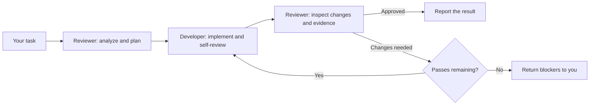

<div align="center">

# PatchDuo

### Give your AI coding agent a reviewer.

A developer agent writes the code. A reviewer agent checks it.
A tracked review loop brings them together inside the coding tools you already use.

[](https://github.com/Tushar-Banswal/patchDuo/actions/workflows/test.yml)
[](LICENSE)
[](package.json)

[Quick start](#quick-start) · [How it works](#how-it-works) · [Integrations](#integrations) · [Contribute](#contribute)

</div>

AI can write a patch quickly. Deciding whether that patch respects your architecture,
handles edge cases, and stays within scope takes another pass.

PatchDuo adds that pass to your development workflow. A separate **REVIEWER**
analyzes your task and writes an implementation brief. A **DEVELOPER** implements
it. The reviewer then checks the changes and returns specific fixes or approval.
The loop continues until approval or your configured iteration limit.

Use it for bug fixes, features, and refactors where you want a second agent to
challenge the implementation before you accept it.

## Quick start

**Requires:** Node.js 18+, Git with an initial commit in your project, and your
chosen coding agent with plugins and separate-agent delegation available.

Choose your integration:
[Claude Code](#claude-code) ·
[Codex CLI and app](#codex-cli-and-app-experimental) ·
[Copilot CLI and VS Code](#github-copilot-cli-and-vs-code-experimental) ·
[Antigravity App and CLI](#antigravity-app-and-cli-experimental).

### Claude Code

Inside Claude Code:

```text
/plugin marketplace add Tushar-Banswal/patchDuo
/plugin install patchduo@patchduo
```

If requested, run `/reload-plugins`, then start a new session in your project.
For explicit control, use `/patchduo:reviewer [scope]` or
`/patchduo:developer [instruction]`. For source development, run
`claude --plugin-dir .` from the checkout.

### Build packages for the other agents

The Codex, Copilot, and Antigravity adapters are **experimental candidates**.
Their installation steps are available for testing; model-driven automatic
activation and delegation remain unverified on those surfaces.

Build their local packages once:

```sh
git clone https://github.com/Tushar-Banswal/patchDuo.git
cd patchDuo
npm run build
```

This creates `dist/codex`, `dist/copilot`, and `dist/antigravity`, along with
local marketplace catalogs. In the commands below, replace
`/absolute/path/to/patchDuo` with your checkout's absolute path. Keep the generated
distribution available while it is used by a local installation.

### Codex CLI and app (experimental)

Register the generated marketplace, install PatchDuo, and register its agents:

```sh
codex plugin marketplace add /absolute/path/to/patchDuo/dist
codex plugin add patchduo@patchduo-codex
node /absolute/path/to/patchDuo/dist/codex/bin/patchduo.js setup --host codex
```

In Codex, open `/hooks` and complete the host's trust review for PatchDuo before
starting a fresh session. Agent setup honors `CODEX_HOME`, otherwise `~/.codex`.

For the **Codex app**, open the registered marketplace in the plugin browser and
install PatchDuo there. Run the same one-time agent setup command for that app's
active Codex home and complete its hook trust review.

### GitHub Copilot CLI and VS Code (experimental)

Install the generated package:

```sh
copilot plugin install /absolute/path/to/patchDuo/dist/copilot
```

For **VS Code**, install the same source with `/plugin install` in the Copilot
harness or through its plugin browser. Enable the host's hook feature and grant
workspace trust where required. Open a fresh session in your project.

The package supplies a session hook, a persistent activation rule, and separate
`patchduo-reviewer` and `patchduo-developer` agents.

### Antigravity App and CLI (experimental)

Validate and install the generated package:

```sh
agy plugin validate /absolute/path/to/patchDuo/dist/antigravity
agy plugin install /absolute/path/to/patchDuo/dist/antigravity
```

For the **Antigravity App**, select that package folder in App Customizations.
Its always-active rule loads PatchDuo on the first model invocation of a new
main-agent session. Antigravity IDE is outside the current integration targets.

### Try your first task

After installation, start a fresh session in a Git project and describe a task:

```text
Fix the pagination bug in the users endpoint.
Keep the response format unchanged and add regression coverage.
```

The intended workflow is reviewer planning, developer implementation, and reviewer
validation. No project configuration file or per-task slash command is required.
For experimental adapters, verify the actual agent calls using the
[live acceptance procedure](docs/verification.md#live-acceptance-procedure).

See the [full installation guide](docs/installation.md) for updating, disabling,
uninstalling, permissions, and host-specific setup details.

## How it works



The orchestrator coordinates the agents and gathers Git diffs and test evidence.
Each fresh agent receives the task, brief, constraints, and previous review issues.

**Illustrative workflow — not a recorded benchmark:**

```text
You        Fix pagination without changing the API response.
Reviewer   Inspect the endpoint; define scope and validation.
Developer  Implement the fix and regression coverage.
Reviewer   REJECTED — the final-page boundary still needs a fix.
Developer  Fix the flagged boundary case.
Reviewer   APPROVED — summarize the reviewed changes and validation.
```

## What you get

| Capability | Why it matters |
| --- | --- |
| Separate planning, implementation, and review | The implementation gets another agent's scrutiny. |
| A concrete implementation brief | Files, constraints, acceptance criteria, and exclusions stay explicit. |
| Reusable review checklists | Review covers security, architecture, system design, and code quality. |
| Bounded fix loops | Rejection escalates to you when the pass limit is reached. |
| Persistent workflow state | Resume and compaction retain the goal, brief, issues, and pass count. |
| Complete Git review scope | Committed, staged, unstaged, and untracked changes remain visible. |
| Approval fingerprints | Changes during review invalidate the verdict; later changes make approval stale. |
| Shared runtime and host adapters | Roles, configuration, checklists, and recovery share one implementation. |

The five checklist skills are `clean-code`, `security`, `architectural`,
`system-design`, and `senior-architect`. You can inspect them in [skills/](skills).

## Integrations

| Host | Activation | Current status |
| --- | --- | --- |
| [Claude Code](#claude-code) | SessionStart hook | Existing integration; automated regression coverage |
| [Codex CLI and app](#codex-cli-and-app-experimental) | SessionStart hook and one-time agent registration | Experimental candidate; live verification pending |
| [GitHub Copilot CLI and VS Code](#github-copilot-cli-and-vs-code-experimental) | Native hook and persistent rule | Experimental candidate; live verification pending |
| [Antigravity App and CLI](#antigravity-app-and-cli-experimental) | Always-active plugin rule | Experimental candidate; live verification pending |

The new adapters have packaging and runtime tests. Automatic activation and
actual agent delegation still require live acceptance checks on each advertised
surface. Antigravity IDE and hosted/cloud agents are outside this release.

See [installation](docs/installation.md) for host-specific setup and
[verification](docs/verification.md) for the evidence required before a candidate
is considered fully supported. Codex requires one-time profile registration and
the host's hook trust review.

## Configure your workflow

Defaults use the session model for both roles and allow **five implementation
passes**. To customize a project, add `patchduo.config.json` at its root:

```json
{
  "max_iterations": 3,
  "reviewer_model": "default",
  "developer_model": "default"
}
```

Model identifiers and available overrides depend on the host. Unsupported choices
stop the implementation loop with an explanation.

Configuration precedence is:

```text
patchduo.config.json → devflow.config.json → CLAUDE.md block → AGENTS.md block → defaults
```

The first available source wins as a whole. Configuration is captured when a
workflow starts; editing it during that workflow does not reset its limit or models.
Both `patchduo:` and legacy `devflow:` blocks remain supported. See the
[configuration parser](lib/config.js) for supported fields and validation.

## Upgrading from DevFlow

PatchDuo is the new name for DevFlow. Install with `patchduo@patchduo` and use
`/patchduo:reviewer` and `/patchduo:developer`. The GitHub repository is now
[`Tushar-Banswal/patchDuo`](https://github.com/Tushar-Banswal/patchDuo). Update saved
clone URLs and marketplace sources to this location.

Existing `devflow.config.json` files and `devflow:` blocks still work.
`patchduo.config.json` takes precedence over the old JSON filename; within each
rules file, `patchduo:` takes precedence over `devflow:`. Active workflow state
keeps its existing storage path, goal, baseline, configuration, and iteration.

Disable or uninstall the old DevFlow plugin before enabling PatchDuo to avoid
running both orchestrators. For Codex, use the old package's
`node bin/devflow.js uninstall --host codex` before removing it, then register
the new PatchDuo profiles. The new setup preserves separately owned DevFlow files.

## Recovery and review evidence

State stays at Git's per-worktree `devflow/state.json` metadata path for
compatibility with existing workflows, outside commits. Each worktree has one
active workflow; linked worktrees are independent.
Sessions and hosts using the same worktree share its state.

PatchDuo records the starting commit once. Before review, the `evidence` command
returns changes committed since that point, separate staged and unstaged patches,
and untracked file names. Committing implementation work does not remove it from
review scope. Resume and compaction preserve the baseline.

Approval is checked against a fingerprint of HEAD, staged and unstaged changes,
and non-ignored untracked files. The orchestrator must pass complete evidence and
invoke the agents and helper correctly. Ignored files, submodule working-tree
contents, and external systems are outside that fingerprint.

For helper commands, phase transitions, and recovery rules, read the
[workflow protocol](lib/workflow.md) and [state helper](hooks/patchduo-state.js).
If a crash leaves a lock, confirm no helper process remains before removing only
`state.json.lock`; preserve the state file.

## FAQ

**Does PatchDuo replace human review?**  
It adds an assisted review loop. It does not guarantee correctness or intercept
every edit, command, commit, or merge. You remain responsible for accepting changes.

**Does it use a separate model service?**  
It uses the host's authentication, models, and tools. Review and fix passes add
model requests, so usage depends on your host, chosen models, and iteration count.

**Can the reviewer edit files?**  
Claude, Copilot, and Antigravity reviewer definitions restrict tools to reading,
search, and web access. Codex reviewer restrictions are instructions; its agents
inherit parent permissions rather than receiving a separate read-only sandbox.

**Will it start coding when I ask a question?**  
Ordinary questions receive ordinary answers. Development tasks enter the tracked
review workflow.

## Contribute

Useful contributions include reproducible bugs, focused regression tests,
checklist improvements, and recorded live host verification.

- [Report a bug](https://github.com/Tushar-Banswal/patchDuo/issues/new) with your host version, OS, reproduction steps, and relevant output.
- Test an experimental adapter using the [live acceptance procedure](docs/verification.md) and share the actual agent/tool traces.
- Propose a change in an issue before building a large feature.

To run the automated checks and build the host packages:

```sh
git clone https://github.com/Tushar-Banswal/patchDuo.git
cd patchDuo
npm test
npm run build
```

The runtime and test suite declare no external npm dependencies. Packages are
generated in `dist/` from shared sources. CI runs tests and builds on Node 18,
20, 22, and 24. Generated packages retain `releaseReady: false` pending live
verification.

## License

[MIT](LICENSE) · Created by [Tushar Banswal](https://github.com/Tushar-Banswal).
